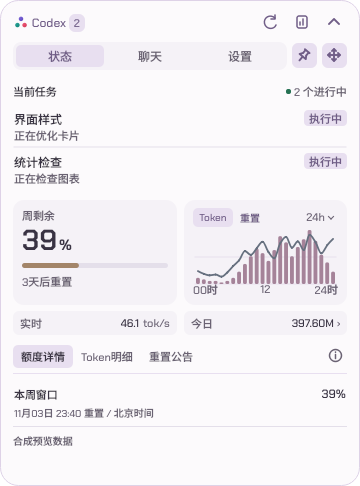
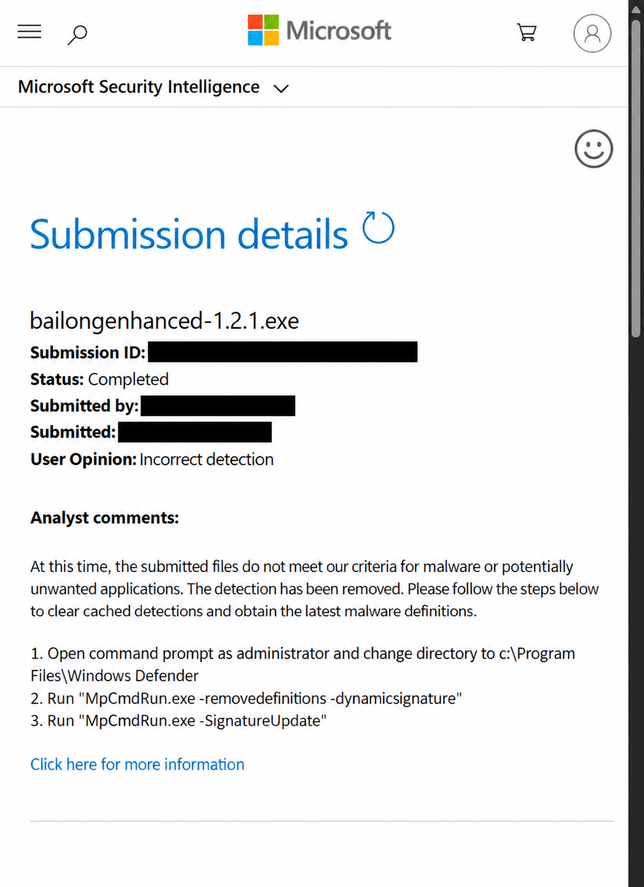

# Codex&GPT桌宠数据中心 | 你桌面的龙娘小助手

在桌面查看 Codex 任务状态、完成提醒、账户额度和 Token 用量，也可以让白龙陪你一起工作。支持仅卡片使用，人物动画按需下载。

**[Windows 首次安装](https://github.com/Wunsch2048/codex-bailong-desktop-pet/releases/download/v1.5.0/bailong-desktop-pet-1.5.0-setup.exe)** | **[程序更新](https://github.com/Wunsch2048/codex-bailong-desktop-pet/releases/latest)** | [Linux 预览版](#linux--niri--kde) | [macOS 社区版](#macos)

Windows 当前公开版 **v1.5.0**。在线安装器直接获取最新累计程序；已有用户可在“设置 → 维护 → 软件更新”升级，无需逐个安装旧补丁。升级保留设置、统计和已下载素材。

## 最近更新

### v1.5.0

- **查成本**可以从项目一路点到某条会话、某轮对话，还能换币种和导出。
- **看额度和速率**可以悬停看图表数字、对照两轮额度，或点击「实时」查看服务状态。
- **和桌宠互动**时，走动中展开卡片会先停下，闲下来再继续走。拖动更跟手，工作时也更安静。
- **打开和维护**更省事，减少日报、设置重开的等待，修复安装管理入口，并补充失败提示。

[查看 v1.5.0 完整更新与下载](https://github.com/Wunsch2048/codex-bailong-desktop-pet/releases/tag/v1.5.0)

## 主要功能

- **任务联动**：查看思考、编辑、命令执行等状态，接收完成提醒，点击会话名跳转。
- **额度与统计**：额度环、重置倒计时、Token 柱线图、实时速率、日报和项目成本估算。
- **桌宠与卡片**：胶囊、正常卡片和大卡片切换；35 个动作、贴边收纳、四种走动方式及八套主题。
- **日常使用**：托盘找回、全屏让位、集成闲聊、连接诊断、应用内更新和版本回退。

查看界面与动效

| 胶囊展开 | 日报展开与收回 |
| --- | --- |
|  |  |

配图使用合成示例数据，历史界面与当前版本可能略有区别。

[完整功能与使用说明](docs/使用说明.md) | [全部版本记录](docs/releases)

## 安装与连接

1. 运行顶部的 Windows 在线安装器，无需 Python 或管理员权限。
2. 在本机安装并登录 Codex，发送一次消息，桌宠会自动发现本机数据。
3. 需要人物时，在设置的素材页下载轻量或高清动画；只用卡片可以跳过。
4. 没有数据时，打开“设置 → Codex → 检测连接与额度”。

仅支持 Windows x64。离线安装、程序位置和数据目录见[快速部署](docs/快速部署说明.txt)；WSL 用户见 [WSL 接入](docs/WSL.md)。闲聊需要自行配置模型服务。

Token 与速率统计覆盖本机可读取的记录；项目成本是 API 等价估算，不是订阅实际扣费。更多口径见[使用说明](docs/使用说明.md#数据和能力的范围)。

## 其他平台

### Linux / niri / KDE

Linux 适配源码已合入主分支，预览包由 [helantianshen](https://github.com/helantianshen/codex-bailong-desktop-pet#linux--niri--kde) 社区维护。当前预览 **v1.4.2-linux-preview.5** 面向 CachyOS/Arch x86_64，要求 **glibc ≥ 2.44**；支持 niri 原生 Wayland 与 KDE Plasma X11/XWayland，不代表覆盖所有发行版。

[下载预览包](https://github.com/helantianshen/codex-bailong-desktop-pet/releases/tag/v1.4.2-linux-preview.5) | [Linux 运行说明](docs/LINUX.md) | [KDE 说明](docs/KDE.md) | [包体与限制](docs/LINUX_PACKAGE.md)

### macOS

[Kki1ds 社区版](https://github.com/Kki1ds/codex-bailong-desktop-pet)提供 Apple Silicon DMG，未公证、无应用内更新。[下载与安装说明](https://github.com/Kki1ds/codex-bailong-desktop-pet/releases)以维护者仓库为准。

社区包由对应作者测试和发布，平台问题请前往对应仓库反馈；Windows 安装器和程序补丁不适用于 Linux 或 macOS。

## 安全反馈

微软已完成对提交的 **1.2.1 样本**的复核并移除该样本检测。结论限于该文件；其他版本、文件及卡巴斯基反馈仍需分别核查。[详细进展与处理建议](docs/安全反馈.md)

微软复核结果（已脱敏）

用户提供的截图已脱敏并整理版面，邮箱、提交编号和精确提交时间已遮挡。判定文字已对照原图核对。

## 文档与反馈

[使用说明](docs/使用说明.md) | [开发与构建](docs/DEVELOPMENT.md) | [维护规范](docs/维护规范验证入口.md) | [迭代历史](docs/迭代历史.txt) | [提交问题](https://github.com/Wunsch2048/codex-bailong-desktop-pet/issues/new/choose)

反馈请附版本、系统缩放和复现步骤，并去掉截图、日志中的私密信息。

## 来源与许可

基于 [jingh12312-rgb/bailong-desktop-pet](https://github.com/jingh12312-rgb/bailong-desktop-pet) 改造。角色形象、原有动作及基础程序来自原项目，增强内容见版本记录。

本项目未统一采用 MIT 许可。发布者获得的公开再分发授权不自动授予访问者商业使用或再分发权；详见 [NOTICE](NOTICE.md)、[原素材说明](docs/upstream/ASSETS.md)及各依赖许可证。

本项目为独立第三方程序，与 OpenAI、Codex 官方无隶属关系。
