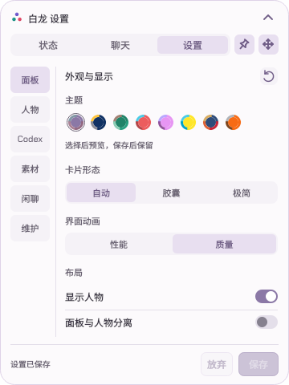

# 白龙桌宠 v1.4.0

相对 v1.3.0 的累计程序更新。已有用户更新这一份程序即可，现有动画继续使用。

## 大卡片重新整理

- 状态、聊天、设置采用统一的紧凑布局。正常卡片原有样式保留。
- 当前任务按会话分行；额度、Token、实时速率和今日用量保持清晰分区。
- 额度详情、Token 明细和重置公告只切换下方正文。长公告按内容增高，返回 Token 明细恢复基础高度；聊天与设置保持固定高度。
- 使用说明改为独立阅读页，集中解释用量、速率、额度、提醒和设置。

## 聊天与设置更好用

- 聊天气泡、复制/重试、固定输入区与聊天服务配置重新排版，保留草稿和流式回复。
- 设置改为侧边分类与固定保存栏；普通按钮用底色显示点击区域，修正更新按钮悬停和图钉图标。
- 图钉、移动按钮使用与正常卡片一致的延迟气泡提示。
- 更多显示选项直接展开，人物锁定、松手惯性和 Windows 启动开关移到主页面，精简重复说明。
- 所有数值输入框禁用鼠标滚轮改值，即使获得焦点也可放心滚动页面；键盘输入和加减按钮继续可用。
- 新一次访问设置复位滚动，子页返回与后台刷新保留正在阅读的位置。

## #22 卡片卡住与入口修复

- 修复动画捕获访问已销毁实时速率控件，导致收起和设置失效的问题。可选控件先检查有效性，交接异常恢复界面操作。
- 关闭面板显示后，从托盘打开设置或聊天会先恢复面板，再进入对应页面。

## 性能与行走优化

- 顶栏、导航、详情与纯展开切换中的图表按边界复用，减少重复控件构造和截图准备；数据变化及时失效，不显示旧内容。
- 修正 Qt 可选组件裁剪的目录覆盖，累计程序包比上一版更小；保留中文字体与软件渲染回退。
- 修复长距离左右行走循环中夹入正面回正的片段。起步、重复中段与停下回正分开，已有动画资源继续可用。
- 修复截图绘制状态传入子控件造成的分隔线末帧色差。

## 稳定性修复

- 修复实时速率气泡在刷新或轻微布局变化时消失又出现。
- 修复 Codex 空闲后仍被旧状态显示为执行中、人物状态动作被自主走动抢占的情况。
- 修复主程序被外部移除后打开安装管理报错；安全告警仍按确切版本和检测记录分别跟踪，本项不代表安全软件已经解除检测。
- 重做正常卡片与大卡片共享模块的双向过渡，处理任务行数变化、小屏裁切、切页残影和取消交接。

## 下载与升级

本版提供累计程序包、在线安装器、离线安装 ZIP 和 SHA-256 清单。人物动画为可选资源，继续使用 v1.3.0 轻量/高清包，无需重新下载。

升级保留本机设置、统计、聊天配置与素材，并保留回退版本。本版按最终候选完成发布检查后交付。配图均使用合成数据。

## 界面示例

以下均为合成数据，未使用真实账号、会话或配置。

