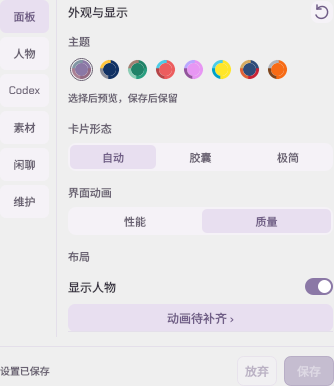

# 白龙桌宠 v1.4.1

修复人物素材恢复及 Codex 启动、关闭联动。已有用户更新这一份累计程序即可；动画继续使用 v1.3.0 的完整资源包，无需重复下载已经完整校验的文件。

## 人物开启却看不见（#23）

- 启动时若人物资源未就绪，会在后台检查受管旧安装和缓存。完整、匹配的资源校验后恢复，不自动联网下载大动画包。
- 旧资源仍缺文件时，设置中的“显示人物”下方提供“动画待补齐”入口，直接进入素材页。主动选择仅卡片时显示启用入口，保持原有选择。
- 补齐时按当前清单的 SHA-256 复用旧文件，再取得缺少的部分；不完整的非活跃缓存会保留，校验和发布失败可恢复，避免先删掉旧动画。
- 自动恢复不改变高清偏好，不打开已隐藏的面板，也不覆盖新的隐藏人物或自定义人物选择。

这是对已复现兼容路径的修复；安装目录本身没有人物素材目录不一定是错误，完整资源也可能保存在独立缓存中。

## Codex 联动

- 修复安装器或工具拉起的桌宠、启动监听，可能在宿主关闭时被一起回收的问题。在 Windows 明确允许时独立运行，保留普通辅助进程原有生命周期。
- 安装完成、回退及失败恢复使用一致的启动方式；监听在最终环境合并后清除安装的一次性交接参数。
- 跟随关闭忽略切换开关、来源后的旧检测结果；WSL 来源不使用迟到的 Windows 结果退出桌宠。
- 保留“先观察到 Codex，再连续确认退出”的判断；短暂重开、仍有其他窗口或读取失败不会直接触发退出。

## 下载与保留

提供累计程序 ZIP、在线安装器、离线安装 ZIP、程序通道及 SHA-256 清单。保留各机器的设置、统计、素材与回退版本。人物资源与程序独立，首次需要时在素材页按需启用。

旧版安全软件反馈继续单独跟踪。本次修复不代表安全软件已经解除检测。

## 界面示例

下图为隔离原生界面与合成配置，不包含真实账号或会话。

