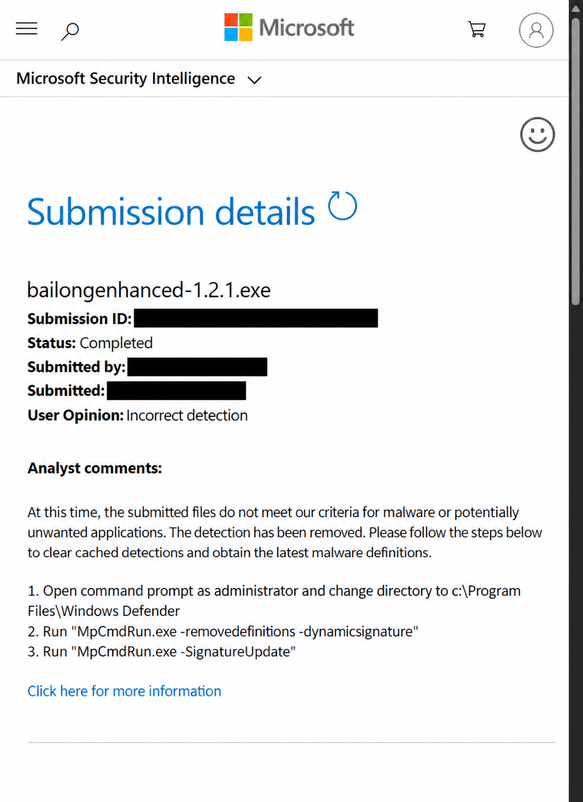

# 安全反馈进展

**2026 年 11 月 1 日更新：微软复核已完成，已移除本次提交样本的检测。**

此前 Microsoft Defender 将所提交的 `bailongenhanced-1.2.1.exe` 检测为 `Trojan:Win32/Bearfoos.A!ml`。提交记录现已显示 **Completed**；微软分析意见说明，该文件不符合其对恶意软件或潜在不需要应用的判定标准，并已移除检测。

*用户提供的复核结果截图，经 AI 脱敏及版面整理；邮箱、提交编号和精确提交时间已遮挡，判定文字已对照原图核对。*

这个结论针对本次提交的 1.2.1 文件，不自动适用于后续版本、其他文件或卡巴斯基的检测。卡巴斯基反馈仍在跟进。若 Defender 仍显示旧检测，请先更新安全情报，并保留新的检测详情；不以关闭防护或添加排除项作为安装要求。相关记录见 [#19](https://github.com/Wunsch2048/codex-bailong-desktop-pet/issues/19) 和 [#1](https://github.com/Wunsch2048/codex-bailong-desktop-pet/issues/1)。

[返回首页](../README.md)
