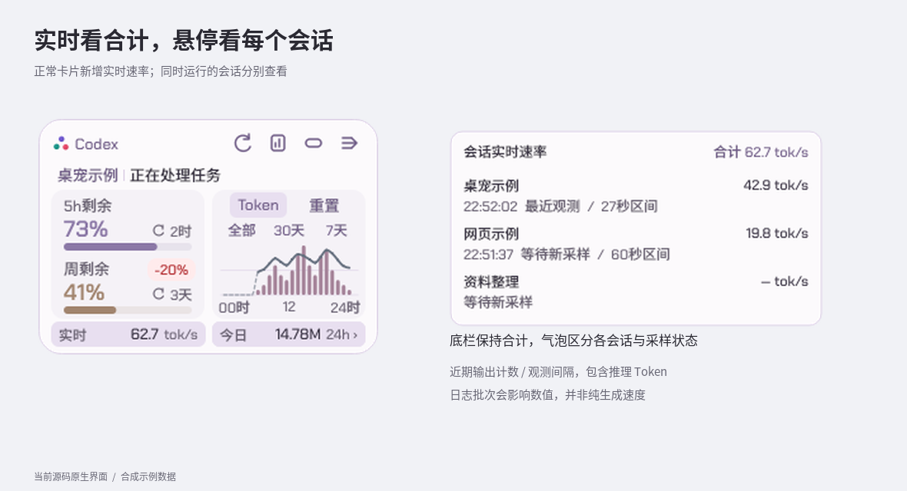
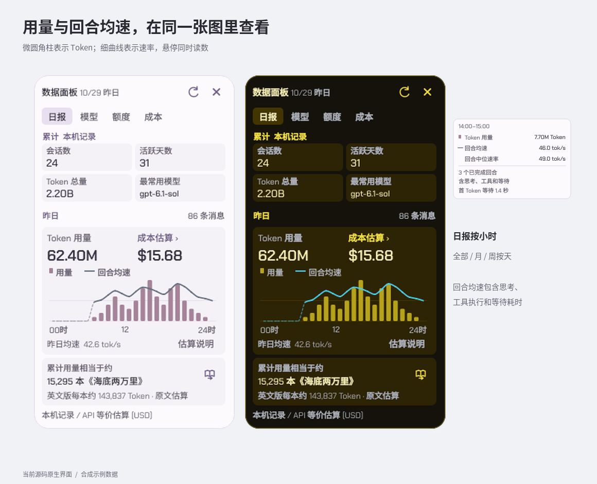
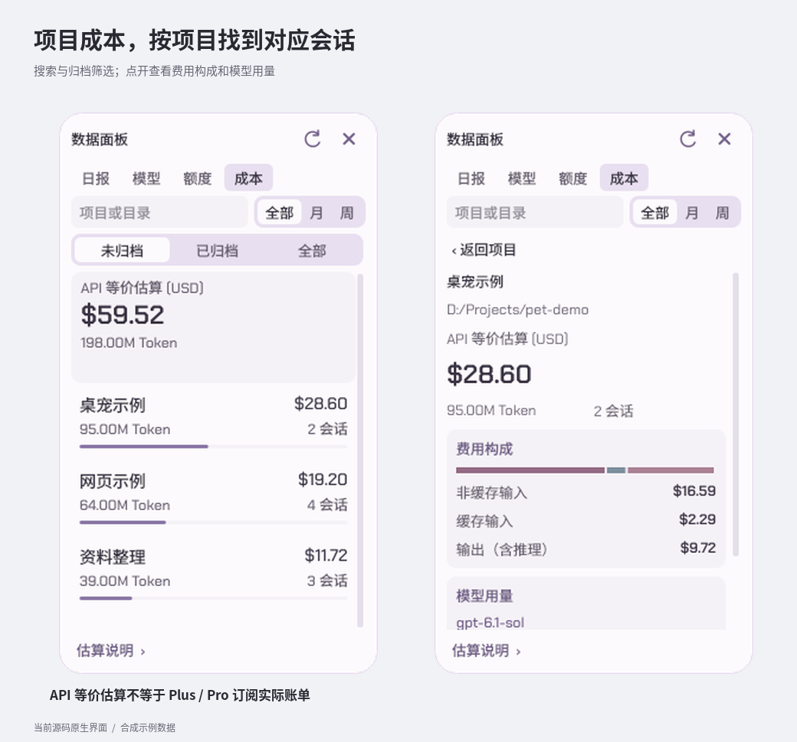
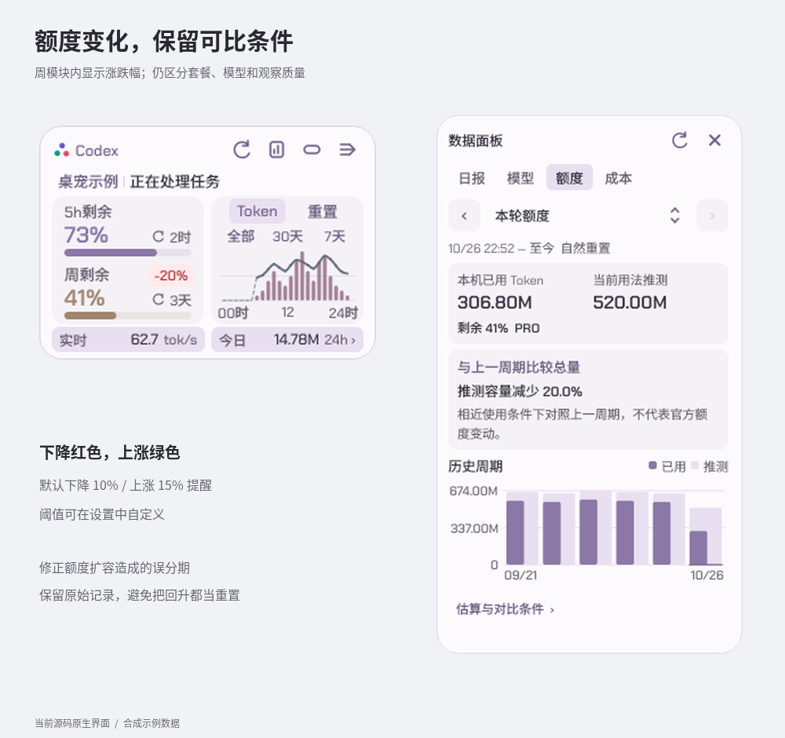
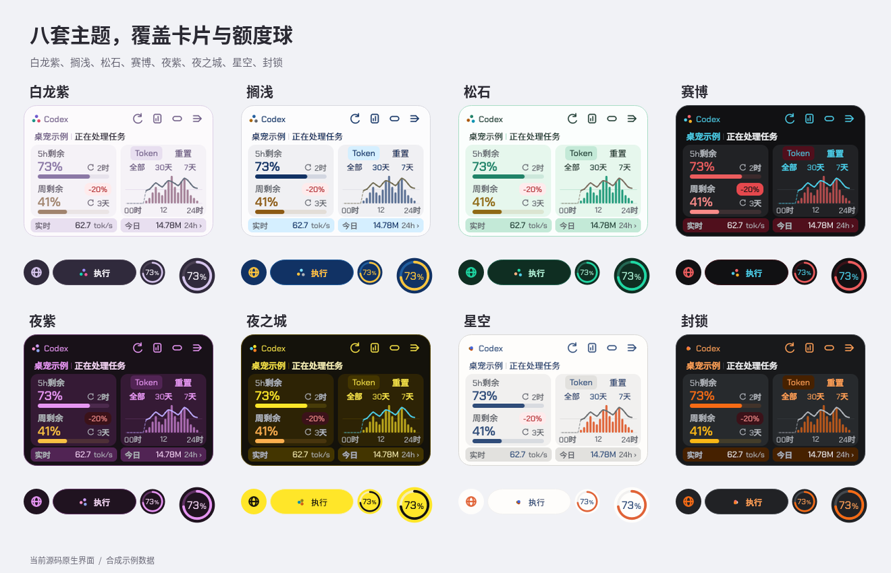
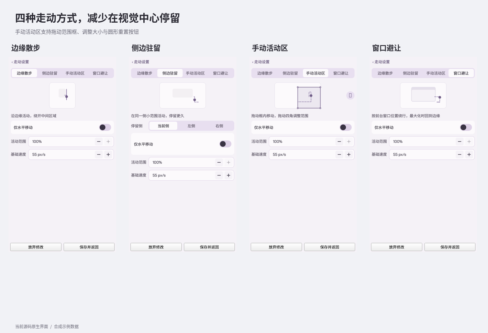
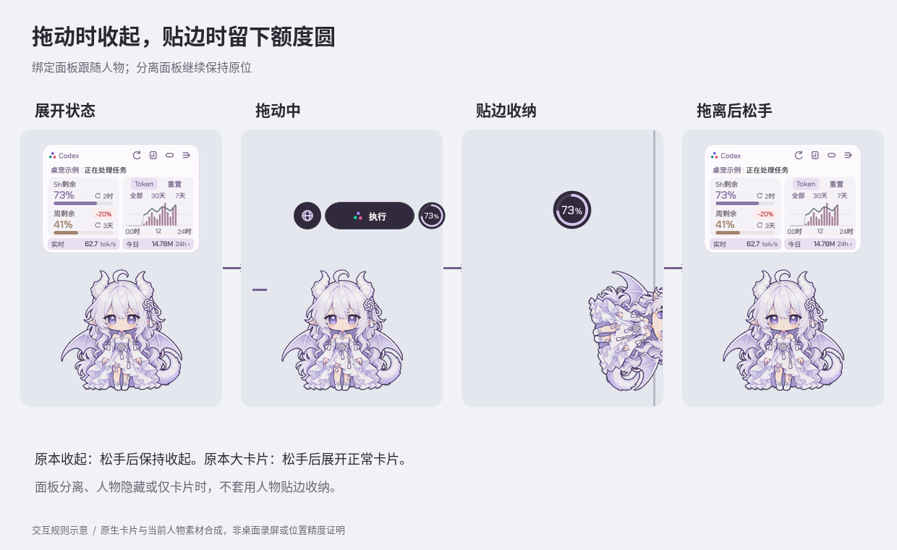
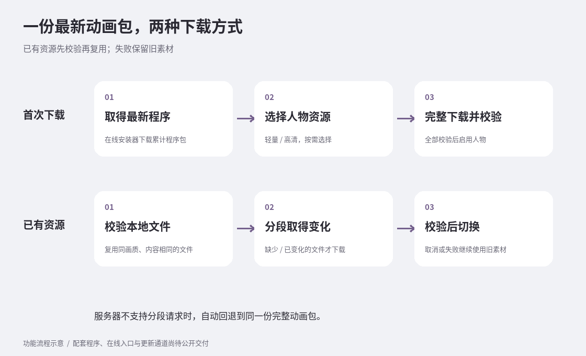
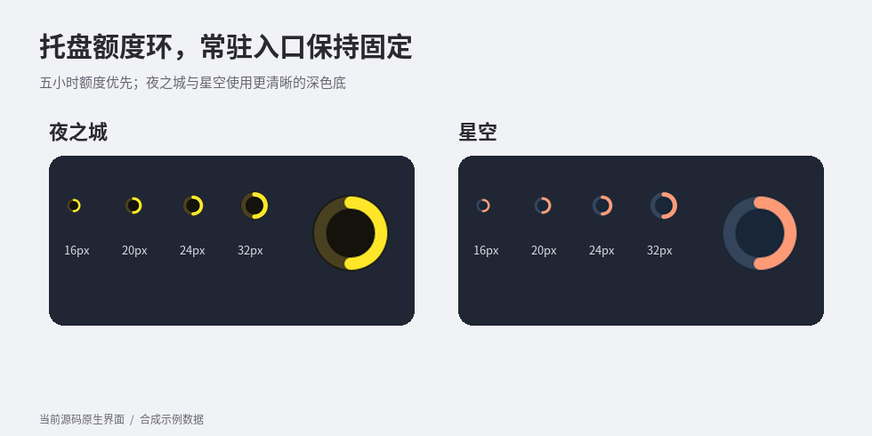

# 白龙桌宠 v1.3.0 程序与动画联合更新

本次更新集中加入项目成本、实时速率、柱线图、八套主题，以及贴边和四种自主走动方式，并改进卡片交接与动画资源更新。

> 相对公开版 1.2.1 的累计更新。配图为合成示例数据；动图的采样方式另有说明。

## 实时速率与用量柱线图

- 历史曲线继续使用按耗时加权的回合均速，悬停新增“回合中位速率”和有效回合数，便于同时了解总体效率和典型回合表现。中位数按有效已完成回合逐个计算，不混入缺失或无效耗时；底栏实时合计口径不变。

- 正常卡片底栏新增“实时”模块，继续显示所有有效会话的合计速率。悬停后按会话分别显示速率、最近采样时间和等待状态，方便判断哪个会话变慢。
- 正常卡片与日报使用微圆角柱线组合：柱表示 Token 用量，细曲线表示回合均速，悬停气泡同时显示两类读数；有记录时补充首 Token 等待时间。
- 全部、月、周范围按天聚合速率，24 小时及日报按小时展示；日报左下改为“昨日均速”。缺少有效观测的历史区间以虚线贴底连接，悬停明确显示未知；有效读数补充回合数和耗时口径，不把缺失数据算作零。
- 修正日志采样较疏时实时速率长期显示“—”的问题。没有有效样本或样本过期时仍保留“—”，不会编造速率。
- “实时”与“今日”底栏等宽；数字贴近右侧单位，数值变化不推动单位。两个模块随正常卡片与大卡片的展开、收回连续过渡。
- 改进日报图表入场：去掉面板展开曲线停稳后的静止等待，柱体从底部连续生长，曲线保持柔和揭示。柱线图入场缩短为 420 毫秒，后台数据在入场结束后统一提交，减少中途重算造成的跳变。

实时速率是近期输出计数增量除以观测间隔，受日志批次影响。回合均速是输出 Token 除以整轮任务耗时，包含思考、工具执行和等待；两者均包含推理输出，不能直接当作模型纯生成速度或服务端限速证据。

## 项目成本与日报

- 数据面板新增“成本”页面，按项目查看 API 等价估算、Token 和会话数。支持项目名称或目录搜索、未归档／已归档筛选，以及全部／月／周范围。
- 项目明细重新分区，展示非缓存输入、缓存输入、输出的费用构成及模型用量。进入时从右侧滑入，返回沿原路退出。
- 日报同一张图表上方并排显示昨日 Token 和成本估算，点击成本可直达昨日项目明细；保持原有日报尺寸。
- 会话迁移到另一个工作区时，按明确的会话成员关系重新归属，避免把旧目录下的所有会话一起迁走。子会话与 fork 分别处理，重复日志及日志改写不会简单累加。
- 改进后台整理的续跑、增量读取和重启恢复，减少反复校验整份旧日志；未识别的模型、无法确定的继承或不完整记录继续明确提示，不静默补成完整金额。
- 新一次进入项目明细时滚动回顶部；返回父列表保留当次筛选和阅读位置，普通数据刷新不打断阅读。汇总随列表一起滚动，滚动过渡更连续。
- 修正成本明细滑入时正文空白、到动画结束才突然出现的问题；新页面布局和文字就绪后才抓取过渡画面，避免只捕获背景。
- 补充旧型号的已核实定价；移除搜索框右侧多余图标，保留即时筛选与回车搜索。

这里的成本是本机日志按版本内置 API 价格折算的等价金额，**不是 Plus / Pro 订阅实际扣费**。未知或缺失记录仍可能使总量不完整。

## 数据库体积与旧数据整理

- 修正成本索引持续追加日志时反复复制旧修订关联的问题，减少无效数据累积及后续备份、校验开销。
- 程序自动识别自身旧索引库，分批整理无效关联，保留 Token、成本、额度、速率与扫描进度；不会删除 Codex 原始会话日志。
- 校验保留记录一致、生成精简统计回退副本后才替换工作库。整理可以中断后续跑；文件占用、空间不足或不支持的旧结构会保留原库并延期。
- 维护复用现有后台索引任务，不额外安装常驻清理程序。只有符合条件的旧库需要处理，正常小库不会反复重建。

旧版本安装器在首次升级前仍可能先备份原来的大库；新程序运行后会补做整理。整理耗时与库大小、磁盘和文件占用有关，不承诺所有机器都能立即完成。

## 额度记录与变化提醒

- 修正额度扩容、余额回升和重启后观察基线恢复等场景，减少把容量变化误拆成新周期的问题；保留原始统计记录。
- 预计 Token 容量按本轮用法推测。只有与上一周期的模型分布、缓存、输入输出及速度和推理档位等条件相近时才判断涨跌；条件缺失或不同仍保留容量估算，但不提示涨跌，避免换模型造成误报。套餐变更不会直接当作缩水。
- 涨跌提醒收进正常卡片的周额度模块，显示带背景的百分比，例如 `-20%` 或 `+15%`。下降红色，上涨绿色，支持自定义阈值，默认下降 10%、上涨 15% 提醒。
- 同时有五小时与周额度时，两类余额均保留，涨跌提示仍属于周额度；点击提示可进入额度页，再点可收回。
- 区分“可开始估算”和“可用于周期比较”：有效观察至少 5 个百分点才开始估算；比较还要求至少 20 个百分点及其他质量条件，不能只看总消耗。
- 估算条件改为独立的局部说明页，避免展开长段文字挤占内容。
- 修正个人重置卡、自然重置、五小时重置与公告之间的关联，未确认来源的本地补充不再直接显示为公告已经到账。

## 八套主题与卡片外观

- 提供白龙紫、搁浅、松石、赛博、夜紫、夜之城、星空、封锁八套主题，并保留自定义颜色。
- 正常卡片与胶囊采用统一的新布局。主题覆盖额度球、进度条、图表与设置，不同主题在主色、次色及背景上作出区分。
- 设置中通过颜色圆选择主题，外圈展示次色；名字只在悬停时显示。点击先预览，点击保存才提交，退出设置恢复尚未保存的颜色。
- 检查并调整浅色、深色主题的正文、说明、富文本、开关及涨跌徽标可读性。白龙紫回归柔和的默认紫灰色调。
- 顶栏四个功能图标更新；三色运行球提高颜色辨识度、减弱发白高光，保留原有运动节奏。胶囊内容变化时居中位置平滑过渡，文字与状态图标作光学校正。
- 模型、额度等柱状图统一微圆角；修正模型图入场末段的像素抖动，去掉模型页多余日期。

## 贴边、拖动与四种走动方式

- 支持手动拖到屏幕左右边缘收纳人物，绑定面板临时转为极简额度圆。拖离侧边后恢复交接，避免反复加载胶囊或进度瞬间到位。
- 拖动人物时，绑定面板临时收为用户原本的胶囊／极简层并跟随。松手后恢复正常卡片；原本已经收起的保持收起，大卡片拖动后恢复为正常卡片。
- 面板与人物分离时，拖动及人物贴边都不带走固定面板；仅卡片、未下载人物资源或人物隐藏时，不误启用人物贴边。
- 独立“走动设置”提供边缘散步、侧边驻留、手动活动区、窗口避让四种模式，并展示路线示意。开启仅水平移动时可以快速穿过中心，但不在那里停留。
- 手动活动区支持拖动整个范围框、拖动四角缩放、框外重新框选和圆形重置按钮；修改沿用保存草稿，不立即覆盖已保存范围。
- 按实际动作匹配位移速度：走路沿用基础速度，跑步为 1.6 倍（最高 300 px/s），左右一致；保留中心区域的快速通过规则，不改现有动作选择。

## 动画资源与更新方式

- 完成上游动作接入和用途适配，两档资源均覆盖 35 个动作；本批包含新增日常动作、走路、跑步和飞行等素材。名字与内容不一致的上游动作按实际内容使用。
- 左右行走采用确认后的素材，左向由右向镜像；移动使用起步、行走中段和回正分段，路程较长时复用中段，停止后接收尾。
- 修正分段接缝重复播放端点带来的停顿，保留前进播放和停止语义。本次不采用尚未认可的左飞 v5 候选，也不宣称所有素材接缝已完全消失。
- 一份最新完整动画包同时供新用户下载和老用户更新。老用户先校验并复用已有同画质文件，只请求缺少或变化的部分；无需再下载独立“增量包”。
- 下载服务器不支持分段时自动回退到完整下载。新素材全部校验后才切换，取消或失败时保留旧素材。
- 新增小型在线安装入口：新用户直接取得最新兼容累计程序包，无需先运行旧基础程序再逐级补丁。人物动画仍按需下载，纯卡片用户可以继续不下载人物资源。

## 窗口交互与稳定性

- 增加“质量／性能”界面动画模式；性能模式减少多数界面动效，不停用人物播放及业务刷新，质量模式仍遵从系统减少动态效果设置。
- 设置页同类普通按钮统一保留悬停填色，避免悬停色与页面背景相同、按钮轮廓消失；主操作和危险操作仍保留各自语义色。
- 移除设置页顶部的 Codex 跳转按钮。
- 升级保留各机器的自定义按钮、网址、胶囊形态与主题；不再自动替换恰好等于旧默认值的走动范围或状态动作间隔，修正分离面板启动位置覆盖；素材暂不可用时保留原先的显示开关。
- 人物隐藏或关闭时取消待触发的延迟点击，避免之后突然播放点击动作或音效；隔离预览和自动化测试始终静音。
- 数据面板每次普通打开默认进入日报，页内按相对位置确定切换方向；页签本身保持原有交互。数据入口和额度入口支持再次点击收回。
- 改进小屏幕打开数据面板时主卡腾位及关闭后的回位过渡；空间不足时日报、额度可无条滚动，模型页协调内外层滚动。
- 修正说明页叠字、悬停层级、按钮选中背景残留、会话文字灰底，以及若干首次打开和窗口交接问题。大卡片默认隐藏滚动条，保留滚动能力；成本列表保留细滚动条例外。
- 托盘采用固定路径宿主与稳定身份，升级继续复用入口。夜之城、星空额度环改用独立深色底，改善小图标辨识；右键菜单点击外部可收起。
- 加强新旧版本启动时的 Qt 环境隔离和 Codex 启动失败保护，减少继承旧组件或失败后重复拉起的问题；保留原始错误，方便定位。

## 安全反馈

部分用户反馈 Microsoft Defender 将公开 1.2.1 的程序检测为 `Trojan:Win32/Bearfoos.A!ml`。对应样本已于 2026 年 10 月 30 日提交微软复核，当前留存状态为 **已提交、待判定**；“申请误报复核”不等于微软已经确认误报。卡巴斯基反馈也尚未获得可确认的检测原因。

本次启动、安装和错误提示改进不代表所有杀软告警已解决；旧样本的复核结果也不能自动代表新包。后续继续跟进复核结果，不以关闭防护或添加排除项作为安装要求。

## 下载与升级

| 使用方式 | 下载 |
| --- | --- |
| 首次安装，约209 KiB | [在线安装器](https://github.com/Wunsch2048/codex-bailong-desktop-pet/releases/download/v1.3.0/bailong-desktop-pet-1.3.0-setup.exe) |
| 已有用户直接升级，约78 MiB | [累计程序包](https://github.com/Wunsch2048/codex-bailong-desktop-pet/releases/download/v1.3.0/bailong-desktop-pet-1.3.0-program.zip) |
| 离线或旧版安装入口，约78 MiB | [Windows x64 安装 ZIP](https://github.com/Wunsch2048/codex-bailong-desktop-pet/releases/download/v1.3.0/bailong-desktop-pet-1.3.0-windows-x64.zip) |
| 可选人物动画，约996 MiB | [轻量动画](https://github.com/Wunsch2048/codex-bailong-desktop-pet/releases/download/v1.3.0/bailong-desktop-pet-1.3.0-animation-light.zip) |
| 可选人物动画，约1.68 GiB | [高清动画](https://github.com/Wunsch2048/codex-bailong-desktop-pet/releases/download/v1.3.0/bailong-desktop-pet-1.3.0-animation-hd.zip) |
| 文件校验 | [SHA-256 清单](https://github.com/Wunsch2048/codex-bailong-desktop-pet/releases/download/v1.3.0/SHA256SUMS.txt) |

人物资源最低需要程序 1.3.0。已有用户优先通过设置里的程序／动画更新入口，旧同画质动画可经校验复用。仅卡片用户只更新程序。

这是累计程序更新，已有用户只需最新程序补丁，无需依次安装历史补丁。程序与动画同批附件共用一个公开版本号，程序更新保留设置、统计及素材偏好。

- 已有用户：先更新配套程序，再按需更新人物动画；已有同画质资源可以复用。
- 新用户：使用本次配套的在线安装器取得最新程序，人物资源可稍后下载。
- 仅卡片用户：不需要下载动画包。

本次程序 ZIP 已包含完整程序运行环境，可以跨过历史补丁直接更新。无需另做一份包含全部动画的大型基底包；保留配套离线程序安装器，供旧版更新入口和离线安装使用。在线安装器本身不内嵌旧程序，下载失败时不会偷偷退回旧基础版本。

本次候选已通过 1,370 项 / 125 模块完整回归、冻结程序源码绑定、TLS 初始化及 100% / 125% / 150% / 200% 原生交互检查。在线安装链 15 项受控传输检查通过，最终离线安装器在空目录准备并启动纯卡片程序通过。检查结果不代表所有显示器场景都零闪烁。正式交付状态以本版 Release 为准。

Windows x64 为本项目维护范围。社区 macOS／Linux 入口及项目来源沿用[仓库首页](https://github.com/Wunsch2048/codex-bailong-desktop-pet)。
